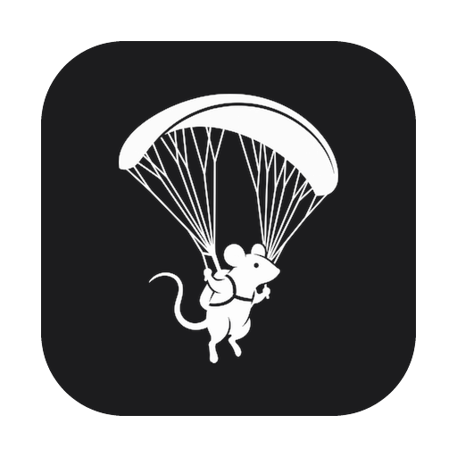
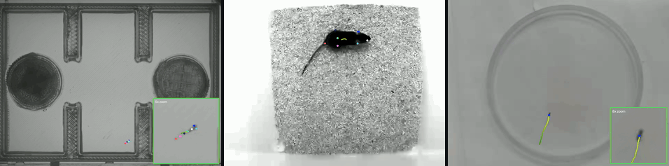
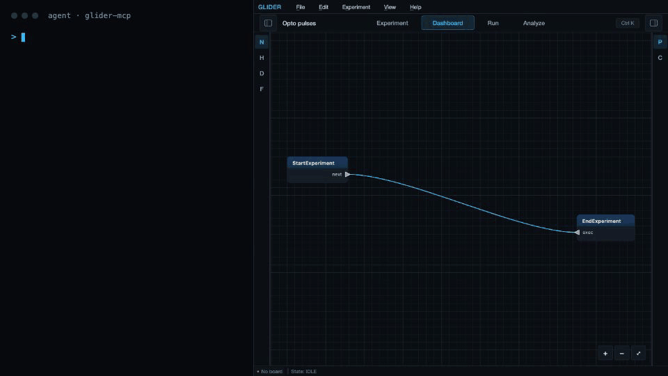
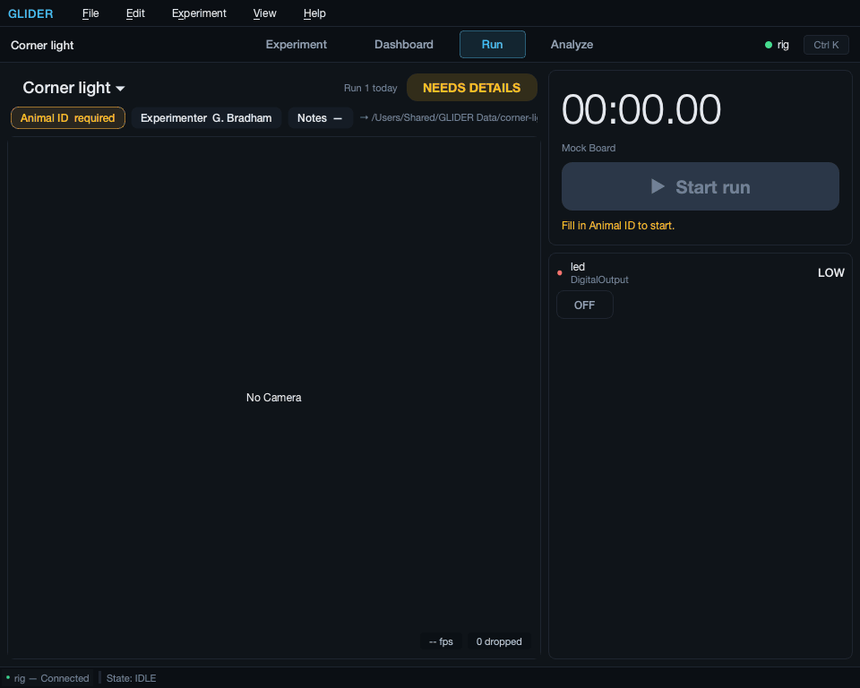
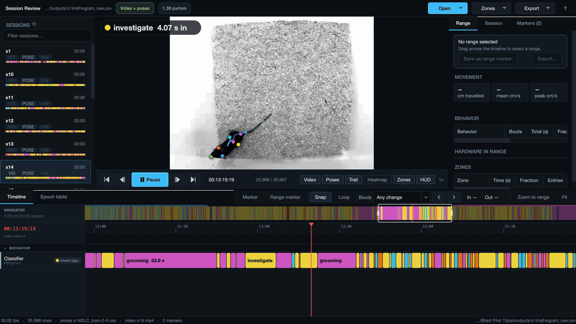

<div align="center">



# GLIDER

**General Laboratory Interface for Design, Experimentation, and Recording**

Build, run, and record reproducible experiments without writing code.

[](https://lainglab.github.io/GLIDER/)
[](LICENSE)
[](https://www.python.org/)
[](#quick-start)
[](https://github.com/LaingLab/GLIDER/releases)

[**Documentation**](https://lainglab.github.io/GLIDER/) ·
[**Quick start**](#quick-start) ·
[**Contributing**](CONTRIBUTING.md)

</div>

macOS / Linux / Raspberry Pi:

```bash
curl -LsSf https://raw.githubusercontent.com/LaingLab/glider/main/install.sh | sh
```

Windows (PowerShell):

```powershell
irm https://raw.githubusercontent.com/LaingLab/glider/main/install.ps1 | iex
```

The installer puts GLIDER in `~/glider` and finishes by running `glider doctor`.
For extras or a manual install, see [Quick start](#quick-start).

---

<div align="center">
  
  <p><em>zebrafish · mouse · fly</em></p>
</div>

GLIDER is a desktop application for building, running, and recording laboratory
experiments. You wire a **visual node graph** that drives hardware (Arduino,
Raspberry Pi, Bluetooth), track animals live on camera, record synchronized
video and data, and review every session afterwards. Experiment files are
portable across Windows, macOS, Linux and the Raspberry Pi.

## Design

Drag nodes onto a canvas and connect them. An experiment is a flow from
**Start** to **End** that writes outputs, reads sensors, waits, loops and
branches on the way, and the same graph drives an Arduino over USB, a Pi's GPIO
pins or a Bluetooth stimulator.

### …or ask an AI agent

GLIDER includes an [MCP](https://modelcontextprotocol.io) server, `glider-mcp`
(the `mcp` extra). An agent (Claude Desktop, Claude Code, Cursor, or any MCP
client) reads GLIDER's catalogue of nodes and devices, writes the experiment, and checks it with
GLIDER's own loader before saving. If the file is open in GLIDER, it reloads on
its own. The server never connects hardware or starts a run; you do that.
[Set it up →](https://lainglab.github.io/GLIDER/reference/mcp/)

<div align="center">
  
</div>

## Run

The **Run** tab puts the camera first: the live view with its frame rate and
dropped frames in the corner, the clock and Start/Stop beside it, and every
device with its live value and its control. Save a setup as a **preset** with
its own per-run fields (Animal ID, postnatal day, …), pick it from the title, and
each run gets its own numbered folder with those values in its CSV headers.

**Rehearse before you run.** *Rehearse from video…* plays a recording through
the live path instead of the camera: tracking runs, Zone Input and Behavior
Input nodes fire, and the hardware is driven for real, on footage where you
already know what the animal did.
[Closed-loop rehearsal →](https://lainglab.github.io/GLIDER/camera-behavior/rehearsal/)

<div align="center">
  
  <p><em>Rehearsing a recording against GLIDER's mock board: the LED is high while the mouse is in the NE corner.</em></p>
</div>

## Review

**Session Review** is an editor laid out like DaVinci Resolve's: the sessions
down the left, grouped by treatment; the video in the middle, with the behaviour
under the playhead; and behaviour and hardware as tracks on one timeline. Drag a
range and the inspector fills with its numbers. Drop markers, share them across
a cohort, and compare every session in an epoch table with a mean and SEM per
group.

<div align="center">
  
</div>

## Also in GLIDER

- **Four tabs** (Experiment, Dashboard, Run, Analyze) and a landing page with
  your recent experiments. Animals, zones and lab vocabulary live on the
  Experiment tab. [Tour →](https://lainglab.github.io/GLIDER/building/builder-window/)
- **Multi-animal pose tracking** with YOLO: one track and one CSV per animal,
  and a sidecar that flags the frames where an identity was inferred.
  [Tracking →](https://lainglab.github.io/GLIDER/camera-behavior/tracking/#multiple-animals)
- **Single-animal DeepLabCut 3.x and SLEAP models** through the `glider-dlc` and
  `glider-sleap` plugins: select the folder your tool wrote and GLIDER converts
  it once.
  [Pose models →](https://lainglab.github.io/GLIDER/camera-behavior/pose-models/)
- **A flow clock**: every timed node runs on one schedule, so latency from a
  slow device is absorbed instead of piling up over a session.
- **Bluetooth peripherals reconnect themselves**, with backoff, and show their
  own link state on every tab.
- **A plugin catalogue**: find, install, enable and reload plugins from inside
  GLIDER. [Plugins →](https://lainglab.github.io/GLIDER/building/plugins/#installing-plugins-from-the-catalogue)

## Prerequisites

1. [uv](https://docs.astral.sh/uv/getting-started/installation/): manages the virtual environment and Python for you
   - Windows: `winget install astral-sh.uv`
   - macOS/Linux: `curl -LsSf https://astral.sh/uv/install.sh | sh`
2. FFmpeg (for video recording)
   - Windows: `winget install "FFmpeg (Essentials Build)"`
   - macOS: `brew install ffmpeg`
   - Linux/Raspberry Pi: `sudo apt install ffmpeg`

> GLIDER runs on **Python 3.12**: it is what CI tests, what the release builds
> ship, and what `.python-version` pins, so `uv` installs it for you. Other
> versions are untested; a fresh install on 3.13 has been seen to fail at
> startup with `DLL load failed while importing QtCore` on Windows. The one
> exception is the Raspberry Pi, which uses the OS's own Python (see
> [below](#by-hand-raspberry-pi)).

## Quick start

One command installs uv and git if they are missing, puts GLIDER in `~/glider`
(or `GLIDER_DIR`), and finishes by running `glider doctor`. Run it again to update.

macOS / Linux / Raspberry Pi:

```bash
curl -LsSf https://raw.githubusercontent.com/LaingLab/glider/main/install.sh | sh
```

Windows (PowerShell):

```powershell
irm https://raw.githubusercontent.com/LaingLab/glider/main/install.ps1 | iex
```

Add extras with `| sh -s -- --extra vision --extra behavior`, or on Windows
`& ([scriptblock]::Create((irm https://raw.githubusercontent.com/LaingLab/glider/main/install.ps1))) -Extra vision,behavior`.

`glider doctor` checks an install at any time: Python, Qt, each extra, FFmpeg
and the inference device, each with the fix for whatever is wrong.

### By hand: Windows / macOS / Linux

```bash
git clone https://github.com/LaingLab/GLIDER.git
cd GLIDER
uv venv
uv sync --extra pc
uv run glider
```

### By hand: Raspberry Pi

PyQt6 comes from apt on the Pi (it is intentionally not a core dependency),
so the venv must be the system Python's, with access to its packages. Install
with `uv pip` and start the venv's own `glider`: `uv sync` and `uv run` would
swap the venv for one on the Python that `.python-version` pins, which cannot
see apt's PyQt6. That makes the Pi's Python the OS's (3.11 on Bookworm), not
3.12.

```bash
sudo apt install python3-pyqt6 python3-pyqt6.qtsvg python3-pyqt6.qtopengl
git clone https://github.com/LaingLab/GLIDER.git
cd GLIDER
uv venv --system-site-packages --python /usr/bin/python3
uv pip install -e ".[rpi,i2c]"
.venv/bin/glider
```

## Optional extras

Add any of these to the sync command with additional `--extra` flags,
e.g. `uv sync --extra pc --extra vision`:

| Extra       | What it adds                                                          |
| ----------- | --------------------------------------------------------------------- |
| `pc`        | PyQt6 + audio — the standard desktop install                          |
| `rpi`       | Raspberry Pi GPIO (gpiozero, lgpio)                                   |
| `vision`    | YOLO tracking (ultralytics)                                           |
| `pose-onnx` | DeepLabCut and SLEAP pose models, run through onnxruntime             |
| `audio`     | Audio recording/playback                                              |
| `i2c`       | I2C devices (ADS1x15, smbus2) — Linux/Pi only at runtime              |
| `spi`       | SPI devices (spidev) — Linux/Pi only                                  |
| `behavior`  | Behavior analysis (UMAP, HDBSCAN, scikit-learn, LightGBM)             |
| `mcp`       | `glider-mcp`, the server AI agents use to design and analyze experiments |
| `dev`       | Test/lint tooling plus the pc+vision+i2c+behavior+pose-onnx+mcp stack |

## Documentation

Full guides live at **[lainglab.github.io/GLIDER](https://lainglab.github.io/GLIDER/)**:

| Guide | What it covers |
| ----- | -------------- |
| [Getting Started](https://lainglab.github.io/GLIDER/getting-started/) | Install GLIDER and build your first experiment |
| [Building Experiments](https://lainglab.github.io/GLIDER/building/) | The node graph, wiring devices, packaging routines |
| [Camera & Behavior](https://lainglab.github.io/GLIDER/camera-behavior/) | Cameras, synchronized recording, tracking, analysis |
| [Runner Mode](https://lainglab.github.io/GLIDER/runner/) | Operating experiments from a touchscreen or Pi kiosk |
| [Pose Models](https://lainglab.github.io/GLIDER/camera-behavior/pose-models/) | YOLO, DeepLabCut and SLEAP models, and the plugins that convert them |
| [Closed-loop Rehearsal](https://lainglab.github.io/GLIDER/camera-behavior/rehearsal/) | Driving the real rig from a recording before an animal is in it |
| [AI Agents (MCP)](https://lainglab.github.io/GLIDER/reference/mcp/) | Letting an agent design experiments and analyze recordings |

## Development

```bash
uv sync --extra dev

# Tests (Qt needs a virtual display when headless)
QT_QPA_PLATFORM=offscreen uv run pytest tests/

# Lint & format
uv run ruff check .
uv run black .
```

## Citation

If you use GLIDER in your research, please cite it:

```bibtex
@software{glider,
  title  = {GLIDER: General Laboratory Interface for Design, Experimentation, and Recording},
  author = {Laing Lab},
  year   = {2026},
  doi    = {10.17632/vd2h64x7wg},
  url    = {https://github.com/LaingLab/GLIDER}
}
```

The data, analysis code and results are archived at Mendeley Data:
<https://doi.org/10.17632/vd2h64x7wg>

## Contributing

Issues and pull requests are welcome. See [CONTRIBUTING.md](CONTRIBUTING.md)
for development setup, coding standards, and the review process.

## License

Released under the [MIT License](LICENSE).
