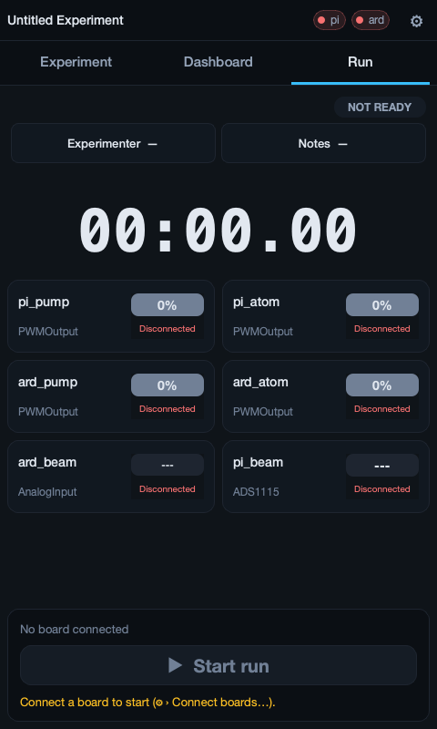

# Runner Mode

Runner mode is GLIDER's touchscreen "kiosk" layout for running experiments at
the bench. It replaces the full desktop editor with a compact header and three
finger-friendly tabs — **Experiment**, **Dashboard**, and **Run** — so an
operator can load an experiment, look it over, drive hardware by hand, and start
a recorded run without a keyboard or mouse.

Runner mode is designed for a small touchscreen — typically a Raspberry Pi with
the official 480×800 display — but it runs on any machine. GLIDER picks the
layout automatically from the screen size, and you can always force it with a
command-line flag.

<figure markdown="span">
  
  <figcaption>Runner mode: large, finger-friendly controls under a header with a ⚙ menu and three tabs, built for a bench touchscreen.</figcaption>
</figure>

## In this section

- **[The Runner Screen](runner.md)** — the header and ⚙ menu, the Experiment,
  Dashboard (graph, panels, manual device controls, Functions), and Run tabs,
  and how to run an experiment from the touchscreen.
- **[Raspberry Pi Kiosk](pi-kiosk.md)** — the prebuilt Raspberry Pi SD-card
  image, the systemd service that auto-launches GLIDER in Runner mode on boot,
  and the update script that moves a kiosk to a newer release.

## How GLIDER chooses Runner mode

When GLIDER starts it looks at the primary screen and decides which layout to
show:

| Screen | Mode |
| --- | --- |
| 480×800 (portrait) or 800×480 (landscape) | Runner |
| Any screen 480 px wide or narrower | Runner |
| A short, wide rotated screen (height ≤ 480 px, wider than tall) | Runner |
| Anything larger (a normal monitor or laptop) | Desktop (Builder) |

You can override the automatic choice from the command line:

```bash
glider --runner     # Force Runner (touchscreen) mode
glider --builder    # Force Desktop (Builder / editor) mode
```

!!! note "One mode per launch"
    GLIDER runs in a single mode for the life of the process. You can switch
    from Runner to Desktop while it is running (**⚙ → Switch to Desktop**; it is
    refused while a run is live), but you cannot switch back to Runner without
    restarting the app. On a dedicated Pi kiosk you normally never leave Runner
    mode.

## Where to start

- Setting up a bench touchscreen from scratch? Start with the
  [Raspberry Pi Kiosk](pi-kiosk.md) page.
- Already have GLIDER running on a touchscreen and want to know what the buttons
  do? Go to [The Runner Screen](runner.md).
- Installing GLIDER by hand on a Pi (no prebuilt image)? See
  [Installation](../getting-started/installation.md).
