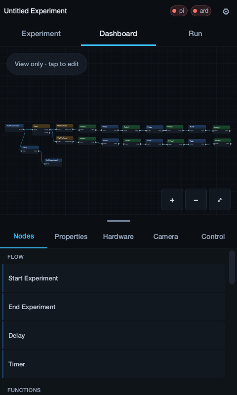

# The Runner Screen

The Runner screen is GLIDER's touchscreen layout. A header runs across the top
of every page, and under it sit three tabs: **Experiment**, **Dashboard**, and
**Run**. This page walks through the header and each tab, and how to run an
experiment start to finish without a keyboard.

<figure markdown="span">
  
  <figcaption>The Run tab before a run — the header and tabs on top, the run details, the clock and a card per device, and the Start run bar at the bottom with a hint about what's still missing.</figcaption>
</figure>

## The header

The header is on every page, so you never lose the essentials. It has two rows.

**Row one** carries, on the left:

- The **experiment name**, followed by an amber **●** while there is
  unsaved work.
- The **run-state pill**, just after the name. It is hidden while GLIDER is
  idle and appears once a run is under way: **Running Starting** as it starts,
  **Running 03:12** while a run is live, **● REC 12:41** when data is being
  recorded, **Running Paused** while paused, **Running Stopping** as it stops,
  and **Error** if the session errors. While a run is live (starting, running,
  paused, or stopping), **tap the pill to jump to the Run tab** from any other
  tab.

and on the right:

- **One dot per board**, labelled with the board's ID — green when the board
  is connected.
- The **⚙ menu** (below).

**Row two** is the tabs: **Experiment**, **Dashboard**, **Run**. There is no
**Analyze** tab on the Pi — the analysis tools are a desktop feature (see
[Switch to Desktop](#switch-to-desktop)).

### The ⚙ menu

The gear opens a menu with everything that used to be a button on a file page:

| Item | What it does |
| --- | --- |
| **New** | Start a fresh, empty experiment. |
| **Open…** | Load an existing experiment file. |
| **Save** | Save the current experiment. |
| **Save As…** | Save the current experiment under a new name. |
| **Connect boards…** | Open the board/port settings; when you close them, GLIDER connects every board (not while a run is live). |
| **Help** | Opens the in-app help. |
| **Switch to Desktop** | Opens the desktop editor (see [below](#switch-to-desktop)). |
| **Exit** | Closes GLIDER. |

**New** and **Open…** are refused while an experiment is running or paused —
they would clear the flow and hardware out from under the run. GLIDER says so on
the notice bar instead.

### The notice bar

Warnings and errors appear in a bar just under the header — a board that lost
its connection mid-run, a connection or start error, a New, Open, or Switch to
Desktop that was refused because a run is live. The bar is deliberately sticky:
a touchscreen operator never sees a small status-bar message that vanishes, so
**a notice stays until you tap it** — anywhere on the bar, or the **✕** at its
right end.

Each notice starts with a glyph for its level — **ⓘ** for information, **⚠** for
a warning or a critical notice — and is tinted to match: blue, amber, or red.
An information or warning notice takes one line; if it is longer than the bar,
it ends in "…". A critical notice wraps onto a second line instead, so more of
it is readable.

A **critical** notice — the "UNSAFE STATE" warning after a run ends in an error,
for example, which means a heater, relay, PWM output, valve, or motor may still
be active — is never replaced by a lesser one. A "Saved" or an informational
message won't bury it; tap it once you've read it.

!!! note "Where is the emergency stop?"
    There is deliberately no separate emergency-stop button in Runner mode. Use
    **Stop** on the Run tab (tap the run pill to get there from another tab). A
    full emergency-stop is a Desktop-mode menu action.

## The Experiment tab

The Experiment tab is where you say what this experiment *is*. A row of
**section chips** runs across the top — **Metadata**, **Animals**, **Zones**, **Lab
Vocabulary**, and **Plugins** — and tapping one shows that section at full width
below. Each section scrolls by dragging with a finger.

These are the same editors the desktop's **Experiment** tab uses, so what you
change here is saved in the same `.glider` file. See
[Subjects & Lab Vocabulary](../building/subjects.md) for the animals and the
vocabulary lists and [Plugins](../building/plugins.md) for the plugin catalogue;
zones are covered under [Camera & Recording](../camera-behavior/camera.md#zones-regions-of-interest).

## The Dashboard tab

The Dashboard tab is the experiment's node graph with the panels you need
beside it. The graph takes the top half of the screen; under it, a **panel
tabs** row switches between **Nodes**, **Properties**, **Hardware**,
**Camera**, and **Control**. The **grip** between the two halves is draggable —
pull it up for more panel, down for more graph.

<figure markdown="span">
  
  <figcaption>The Dashboard tab — the graph on the top half (locked, with its zoom and fit buttons), the grip, and the panel tabs with the Nodes list underneath.</figcaption>
</figure>

### Viewing and editing the graph

The graph starts **locked**: a pill in its top-left corner reads **View only ·
tap to edit**. While it is locked you can:

- **Pan** with a one-finger drag over empty canvas.
- **Zoom** with the **+** and **−** buttons, and **fit** the whole flow to the
  view with the third button.

You cannot move, connect, delete, or add nodes. **Properties** is read-only and
**Hardware** hides its add, edit, and remove controls, so an accidental tap
can't change the experiment.

Tap the pill to switch it to **Editing · tap to lock**, which unlocks all of
that. Tap it again to lock the graph.

!!! note "A running experiment locks the graph"
    While an experiment is running or paused the lock is forced on and the pill
    can't be changed. The graph stays locked after the run ends; unlock it when
    you want to edit again.

### The panel tabs

| Tab | What it holds |
| --- | --- |
| **Nodes** | The node library. **Tap a node to drop it in the middle of the graph.** Dragging one onto a precise spot needs a press-and-hold first. Both are refused while the graph is locked. |
| **Properties** | The selected node's settings. **Tapping a node on the graph while editing opens this tab.** Read-only while the graph is locked. |
| **Hardware** | Your boards and devices. **Connect boards…** at the top opens the board/port settings and then connects every board, the same as the ⚙ menu item. While the graph is unlocked, **+ Board** and **+ Device** appear and boards and devices can be edited or removed; while it is locked those are off (connecting and disconnecting still work). For what the device types mean and how to wire them, see [Devices & Hardware](../building/devices.md). |
| **Camera** | The live camera view and recording controls. For how the camera, recording, and behavior tracking work, see [Camera & Recording](../camera-behavior/camera.md) and [Tracking](../camera-behavior/tracking.md). |
| **Control** | Drive hardware by hand, and run your saved functions. See [below](#the-control-tab). |

Every panel scrolls by dragging with a finger; the thin bar at the edge is only
an indicator.

### The Control tab

Control lets you drive hardware by hand — turn an output on, nudge a value, take
a reading, or run a saved function — without starting a recorded experiment. The
controls are **generated automatically** from whatever devices are connected:
GLIDER inspects each device's actions and builds the right control for each one.
That means custom and plugin devices get correct, range-aware controls with no
extra work.

!!! note "Control reflects your current hardware"
    Every time you open the Control tab, its controls rebuild to match what's
    connected right now. If you connect a board from **Hardware** and then tap
    **Control**, the new device's controls appear.

#### Per-device controls

For each device you'll see a heading with the device's name, followed by one
control per action:

| Device action | Control you get |
| --- | --- |
| An on/off (switch) action | An **ON/OFF toggle** button. Tap to flip it. |
| A whole-number value (e.g. an angle, a duty cycle) | A **slider** paired with a **number box**. Drag the slider — the value only commits when you release, so the device doesn't ramp through every value in between — or type an exact number / nudge it by its step in the box. |
| A very large numeric range | Just the **number box** (a slider that fine would be unusable on a touchscreen). |
| An action that takes no value | A single **command button** that fires the action. |
| A readable measurement | A **Read** button with a value shown next to it. Tap Read to take a fresh reading. |

Redundant controls are folded away automatically: a digital output shows a
single ON/OFF switch (not separate On, Off, and Toggle buttons), and a value
output shows one slider rather than duplicate controls.

All values are clamped to each device's declared safe range before they're sent,
and commands to a single device are sent one at a time.

#### The Functions section

If the loaded experiment defines any **functions** — reusable action sequences
built as a `StartFunction → … → EndFunction` chain in the graph — a
**Functions** section of large run buttons appears above the device controls.
Tap a button to run that function once against your hardware.

- While a function runs, its button is disabled and shows **"— Running…"**, so
  you can't accidentally start it twice.
- Some functions ask for a value first (for example, a number of revolutions).
  A prompt appears; enter the value to run, or cancel.
- If a function stops responding it is cancelled automatically and a notice
  appears in the status strip.

Functions are for manual, one-off actions between runs. They are gated so they
can never overlap a real experiment:

!!! warning "Functions can't run during an experiment"
    A manual function and a recorded experiment both drive the same hardware, so
    GLIDER refuses to start a function while an experiment is running or paused,
    and refuses to start one while another function is still running. You'll see
    a message like "Stop the experiment before running a function manually." You
    also need a board connected to run a function.

To learn how functions are built, see [Functions](../building/functions.md).

#### The status strip

A status strip sits at the bottom of the Control tab. It shows failures and
warnings as an icon plus text and **keeps them visible until something replaces
them** — for example, if a command fails, if a value had to be clamped, or if a
function couldn't run. If you tap an ON/OFF switch and the command fails, the
switch flips back to its real state and the reason appears here.

## The Run tab

The Run tab is where you start, watch, and stop a recorded experiment. Top to
bottom:

- **Run details.** The per-run fields your experiment asks for — **Dam ID** or
  **Animal ID** and **Group**, say, plus **Experimenter** and **Notes**. Tap a
  field to type its value. Fields marked required **block Start** until they're
  filled in. (The fields come from the experiment file you opened; there is no
  preset picker on the Pi, so choose or edit presets on the desktop.) The
  details lock while a run is live.
- **Animal.** Beside the pill, pick which animal from the experiment's
  **Animals** list this run is of. Its details are written into the run's CSV
  headers. The choice locks while a run is live.
- **A status pill** at the top right, above the details: **NOT READY** (no
  board connected, or no runnable flow), **NEEDS DETAILS** (a required field is
  empty), or **READY**. An experiment with no boards configured (video only,
  say) needs no board, so it can be **READY** with nothing connected. While a
  run is under way the pill shows the state instead — **INITIALIZING**,
  **RUNNING**, **PAUSED**, or **STOPPING** — and **ERROR** if the session
  errors.
- **The clock.** A large clock counts up while a run is live and freezes while
  paused.
- **Device cards.** A card per device, in two columns, showing the device's name,
  its type, a live value badge (an output's level, an input's reading), and a
  link word under it — **Ready** once the device is initialized, **Disconnected**
  while its board isn't connected.
- **The camera video.** When the camera is streaming, its live view appears
  between the cards and the run bar.
- **The run bar.** At the bottom, a line about the board and the buttons.

### Start, Pause, and Stop

When idle, the run bar shows a big **▶ Start run** button. It is enabled only
when you're ready: a board is connected (or the experiment configures no
boards), the experiment has a Start Experiment node, and every required run
field is filled in. Until then it is greyed out and a hint under it says what's
missing:

| Hint | What to do |
| --- | --- |
| **Fill in Dam ID to start.** (or whichever field is required) | Tap the field in the run details and enter a value. |
| **Connect a board to start (⚙ › Connect boards…).** | Open the ⚙ menu, choose **Connect boards…**, check each board's port, and tap **Save**; GLIDER then connects the boards. |
| **Add a Start Experiment node to the flow to start.** | Open the **Dashboard** tab, unlock the graph, and add one. |

While a run is live the bar becomes **Pause** (which turns into **Resume** when
paused) and **■ Stop**. Stop ends the run at any time.

To stop from another tab, **tap the run pill in the header** — that jumps to the
Run tab — and tap **Stop**.

!!! tip "Stopping loads a clean time"
    When a flow finishes, the clock snaps to the experiment's true logical
    duration rather than the last timer tick, so repeated runs of the same flow
    report a consistent elapsed time.

## Switch to Desktop

**⚙ › Switch to Desktop** opens the desktop editor in place: the normal header
with the **Analyze** tab, and the node graph with its side panels. Nothing is
reloaded — your experiment, hardware, and camera carry over. The **Run** tab
stays the Pi's run page.

- It is **refused while a run is live** — GLIDER tells you to stop the
  experiment first.
- It is **one-way**. You cannot return to the Runner layout without restarting
  GLIDER. On a dedicated bench kiosk you normally leave this alone. See
  [Runner Mode](index.md#how-glider-chooses-runner-mode) for why.

## Running an experiment from the touchscreen

Here's the whole loop:

1. **Load your experiment.** Tap **⚙ › Open…** and choose your experiment file
   (or **New** to start fresh). Check the details on the **Experiment** tab if
   you like. The experiment says which boards it uses, so load it first.
2. **Connect your hardware.** Tap **⚙ › Connect boards…**, check each board's
   port, and tap **Save**. GLIDER connects the boards, and each board's dot in
   the header turns green.
3. **(Optional) Look over the flow.** On the **Dashboard** tab the graph is
   locked, so you can pan, zoom, and fit it without changing anything.
4. **(Optional) Check your rig by hand.** On the Dashboard, open **Control** and
   use the auto-generated controls — toggle an output, nudge a value, take a
   reading, or run a Function — to confirm everything responds before you
   record.
5. **Fill in the run details.** On the **Run** tab, tap each field the
   experiment asks for (a Dam ID, say). The pill changes from **NEEDS DETAILS**
   to **READY**.
6. **Start the run.** Tap **▶ Start run**. The clock starts, the pill turns to
   **RUNNING**, and the header pill shows **Running** (or **● REC**) with the
   elapsed time.
7. **Watch it go.** Stay on the Run tab, or move to another tab — the header pill
   keeps the state and time with you, and the graph is locked so nothing can be
   changed by accident.
8. **Stop when done.** Tap **■ Stop** on the Run tab (or tap the header pill to
   jump there first). The run ends and the clock settles on the experiment's
   final duration.

!!! tip "First launch"
    The very first time GLIDER starts, it shows a short welcome dialog and tells
    you where your experiments and recordings will be saved. On a touchscreen the
    dialog simply offers **Start** and **Open User Guide** — tap **Start** to go
    straight to the Runner screen. (The interactive spotlight walkthrough,
    **Take the Tour**, is offered in Desktop mode, where it can point at the
    editor's panels.)
